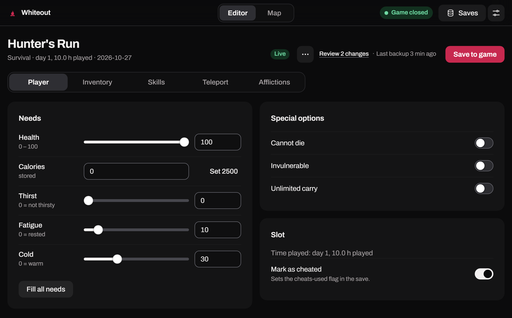
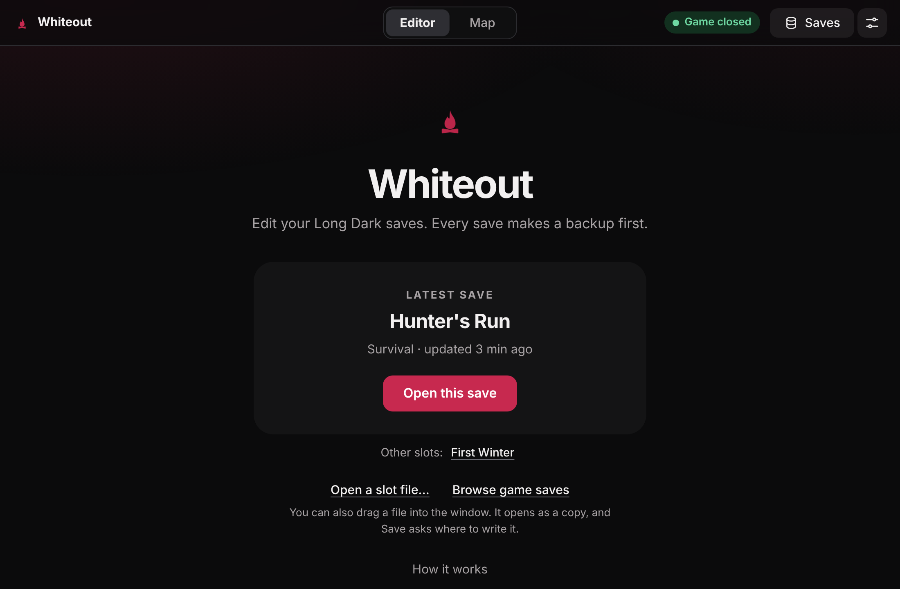
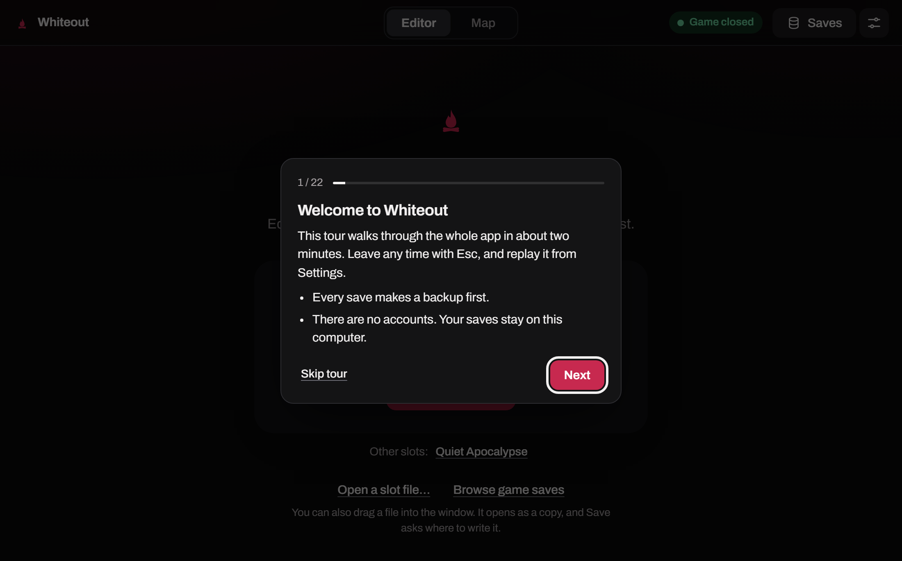

<h1 align="center">Whiteout</h1>

An open source save editor for <b>The Long Dark</b>. Windows, macOS and Linux. No account, no cloud.

  
  
  
  
  

<a href="https://whiteout.sinerla.fi/">whiteout.sinerla.fi</a>

> [!IMPORTANT]
> Installers are on the [Releases](https://github.com/Sinerla-Development/Whiteout/releases) page. What changed in each version is in the [changelog](CHANGELOG.md), and there is more at [whiteout.sinerla.fi](https://whiteout.sinerla.fi/).

## What it does

You open a slot, change what you want and save. Whiteout backs up the old file first, every time, so you can always go back.

1. Health, needs, inventory, skills, afflictions, time, aurora and the cougar
2. A More tab for Well fed, nutrition, illnesses, missions, transmitters and game stats
3. A Trader card where you can change your trust and see the trade you agreed and what is on offer this aurora, with prices in plain names
4. Teleport by coordinates, a bookmark or a click on the map
5. A list of your changes before anything is written, and it won't let you save values that would break the slot
6. The open slot updates by itself when the game saves
7. If your slot disappears while the game runs, like when you die, Whiteout keeps a copy
8. A map with your position, the path you walked and your own pins, plus an overview of the whole island
9. A map remote, a global hotkey (Ctrl+Alt+W by default) that lets you pick teleports with number keys while the game is in front, so you can keep the map on a second screen
10. One search box for every tab, press / to jump to it
11. Loadouts you build yourself, and you can copy items from another slot
12. Your pins and loadouts can live in iCloud, Google Drive, OneDrive or Dropbox, so they follow you to other computers

Everything on the More tab has been tried in the game. [docs/MORE-FEATURES.md](docs/MORE-FEATURES.md) lists what each feature writes to the save and what was left out until it has been tested.

## Screenshots

  
  

## Privacy

Whiteout works offline and your saves stay on your computer. Only two things ever go online, and both ask you first. The map images come from Steam, so Steam sees your IP address when they load. The update check talks to GitHub once a day at most, and nothing gets installed until you press Install. On Windows the window runs on Microsoft's WebView2, which can talk to Microsoft on its own. No analytics, no telemetry, no account.

## Install

Close the game before you save to it, Whiteout won't write while it's running.

On Windows run the `.exe`. The builds aren't signed yet, so SmartScreen may complain, just press More info and Run anyway. On macOS open the `.dmg` and drag the app to Applications. The first time macOS blocks it, so open System Settings, go to Privacy & Security and press Open Anyway. On Linux use `sudo apt install ./Whiteout_*.deb` or run the `.AppImage`. Whiteout is tested on Windows and macOS. The Linux builds are not tested yet, so expect rough edges there. It looks for saves from the native game, Proton and Flatpak Steam. If the window stays blank, start it with `WEBKIT_DISABLE_DMABUF_RENDERER=1 whiteout`.

## Thanks

Huge thanks to [HokuOwl](https://steamcommunity.com/profiles/76561198212232496). Their [Updated Region Maps [2025]](https://steamcommunity.com/sharedfiles/filedetails/?id=3255435617) guide is what makes the map view possible, and they kindly let Whiteout use the maps. The images aren't bundled with the app, they load from Steam when you open the map. Skill levels come from [The Long Dark Wiki](https://thelongdark.fandom.com/). The Game World Map, Langston Mine map and Transition Cave map are by [Krueger](https://steamcommunity.com/profiles/76561198054890338), from their guide [Tales from the Far Territory map locations](https://steamcommunity.com/sharedfiles/filedetails/?id=2899955301). Krueger shares the maps freely with credit to the creator and the source.

## Collaboration

Whiteout is made by [Sinerla Development](https://github.com/Sinerla-Development). We're teaming up with [Tinkes Productions](https://github.com/Tinkes-Productions) on what comes next, and joint work shows up here when it ships.

## Not affiliated

Whiteout is an independent fan project and has not been authorized, sponsored, or otherwise approved by Hinterland Studio Inc. The Long Dark is a trademark of Hinterland Studio Inc., registered in the United States and other countries. Editing saves can break them, so keep your backups.

## License

[MIT](LICENSE). The licenses of the bundled components and the [Archivo](https://github.com/Omnibus-Type/Archivo) font are in [THIRD-PARTY-NOTICES.txt](THIRD-PARTY-NOTICES.txt). Found a security problem? See [SECURITY.md](SECURITY.md).
